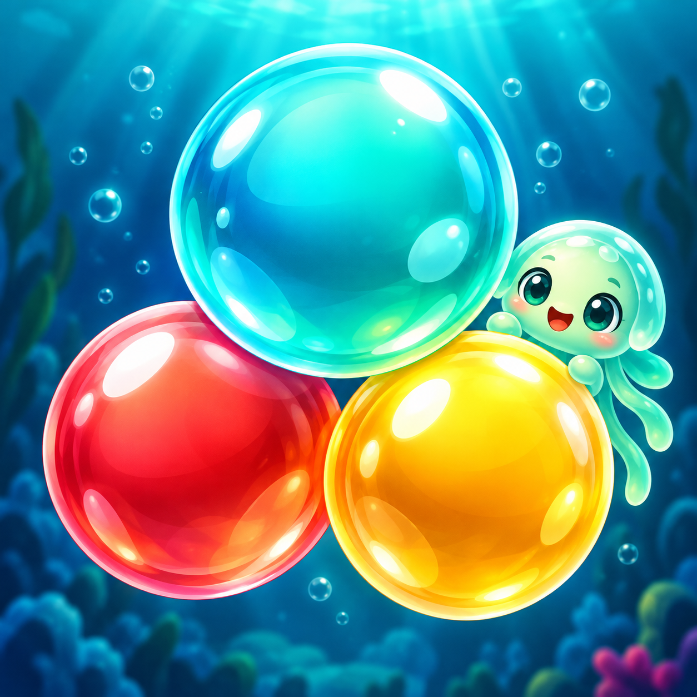

# Bubble Pop: Reef Rescue

### Pop a little color. Rescue a little wonder.

An ocean-inspired bubble shooter by **gillanitech**. Aim carefully, match colorful bubbles and rescue reef friends across **1,000 levels**.

## Meet your next reef adventure

- **1,000 levels across 20 sectors:** discover new ocean palettes as you progress.
- **Aim, match and pop:** connect matching colors, clear supports and drop floating clusters.
- **More than one objective:** clear colored bubbles, rescue reef lights and collect beacons.
- **Tools that grow with you:** unlock color changes, extra shots, prism pearls, bombs and other tools as new obstacles arrive.
- **A reef with surprises:** ice shells, basalt, hidden colors, key gates and whirlpools add new decisions.
- **My Music:** choose your own audio file through the Android picker, adjust volume and loop playback, or return to the original soundtrack. Music-note shortcuts are available on the map and during play.
- **Play at your pace:** pause whenever you need, and adjust music, sound and vibration.

## How to play

1. Choose an available level on the ocean map.
2. Drag to aim, then release to shoot. Use the colored guide to line up your shot.
3. Match at least three bubbles of the same color. Clear supports to drop detached groups.
4. Tap the loaded or next bubble to swap them.
5. Complete the level objective before your shots run out. New tools and mechanics include gameplay instructions when introduced.

**Tip:** A carefully placed bank shot can reach bubbles hidden behind an obstacle. Use each booster for the obstacle it is designed to solve.

## Your progress and settings

Progress is stored on your device. No game account is required. Clearing app storage can erase your levels, coins, boosters and settings. The current game does not offer a cloud-save account or manual cross-device restore.

The Android testing build requires **Android 8.0 or newer** and a matching CPU architecture. Testing APKs are supplied separately; this privacy repository does not host APK downloads.

## Advertising and privacy

The game includes Google AdMob rewarded ads and occasional interstitial ads. Current testing builds use test-ad identifiers. Available consent and ad privacy controls depend on your region and configuration.

Personal audio selections and playback preferences stay in the local save. The My Music feature does not upload selected audio. See the policy for cloud-provider access, retained file permissions and removal of saved references.

Read the [Privacy Policy](index.html), including local-save deletion instructions and advertising disclosures. The website adds no analytics, advertising, cookies, external fonts or third-party JavaScript.

## Player support

**Developer / publisher:** gillanitech  
**Email:** [hafizsyedhabibahmadgillani@gmail.com](mailto:hafizsyedhabibahmadgillani@gmail.com)

For a bug report, include your phone model, Android version, level number, app version and the steps that caused the problem. A screenshot or short recording can help. Do not send passwords or sensitive personal details.

For privacy requests, use the subject **Bubble Pop privacy request** and explain which information your request concerns.

---

## About this repository

This repository contains the public privacy-policy website and player guide for **Bubble Pop: Reef Rescue**. It does not contain the Unity game source or a Play Store release.

**Suggested repository name:** `bubble-pop-reef-rescue-privacy`  
**Repository title:** Bubble Pop: Reef Rescue — Privacy & Player Support  
**Repository description:** Official privacy policy and player guide for Bubble Pop: Reef Rescue by gillanitech. Local saves, advertising choices, data deletion and support.

### Publish with GitHub Pages

1. Create a GitHub repository, for example `bubble-pop-reef-rescue-privacy`.
2. Upload the **contents** of this folder to the repository root. Keep `index.html`, `.nojekyll`, `README.md` and the `assets` directory together.
3. Open **Settings → Pages → Build and deployment**.
4. Select **Deploy from a branch**, then **main** and **/ (root)**. Save.
5. Wait for the Pages deployment to finish. GitHub shows the published website URL in Settings → Pages.
6. Open that URL on desktop and mobile. Use the live HTTPS page URL as the privacy-policy URL in the app and Play Console.

For the example repository name, the usual project URL is `https://YOUR-GITHUB-USERNAME.github.io/bubble-pop-reef-rescue-privacy/`. Replace the username with your actual account. No GitHub username or live deployment URL has been assumed.

The site uses relative asset paths and works under a project subdirectory. No npm install, build command, API key or external hosting service is required.

### Preview locally

Open `index.html` directly in a browser, or run `python -m http.server 8080` from this directory and visit `http://localhost:8080`.

### Files

- `index.html` — complete readable policy, contact details and metadata.
- `assets/styles.css` — responsive ocean-inspired design, keyboard focus and print styles.
- `assets/site.js` — reading progress, active section and print button. Policy content remains readable without JavaScript.
- `assets/app-icon.png` — original game icon used for branding and favicon.
- `.nojekyll` — keeps the site as plain static files on GitHub Pages.
- `PUBLISHING-NOTES.md` — implementation evidence, release checks and copy-ready listing text.

### Keeping the policy accurate

Update the policy and its date when data handling changes. Recheck it before enabling live advertising, adding mediation, accounts, analytics, cloud saves or purchases. Complete the Play Console Data safety form for the actual released build; this website does not automatically submit it.

The current app's privacy/info dialog still needs its final live policy URL wired in after publication. Children/audience and ad-serving settings must be confirmed before a store release; the policy does not claim certification for a children's programme.

© 2026 gillanitech. Game artwork and branding are not licensed for reuse by this repository.
